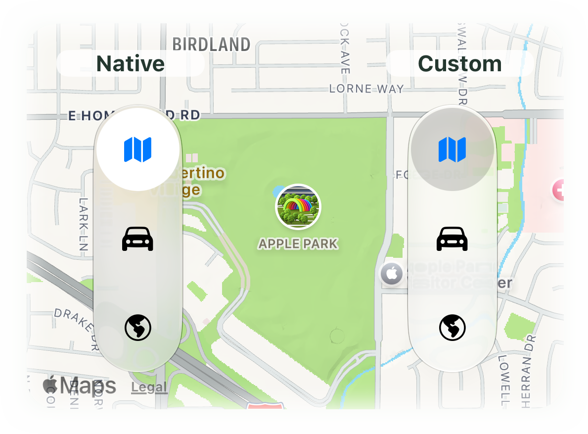

# TiVerticalSegmentedControl

<p align="left">
  <picture>
    <source media="(prefers-color-scheme: dark)" srcset="assets/TiVerticalSegmentedControl-Dark.png">
    <source media="(prefers-color-scheme: light)" srcset="assets/TiVerticalSegmentedControl-Light.png">
    
  </picture>
</p>

## UIKit Vertical Segmented Controls for Titanium 🚦 

Module ID: `ti.verticalsegmentedcontrol`. Version: **0.1.1**. Requires **iOS 27+**, Titanium **13.4.1.GA+**, and a compatible Xcode 27 SDK.

Both styles use a real `UISegmentedControl`, rotated vertically with upright SF Symbols:

- **`native`**: system selection appearance inside a regular glass capsule, corresponding to the sample's segmented Picker version.
- **`custom`**: configurable selection tint inside an interactive glass capsule, corresponding to its UIKit-backed version.

The module uses UIKit without SwiftUI hosting. Selection animation and touch tracking come from the system control. It emits selection events; the application owns its screens or map modes.

## Install

Build output: `ios/dist/ti.verticalsegmentedcontrol-iphone-0.1.1.zip`. Extract its `modules/` tree into your application's project directory, or install it using your normal Titanium module workflow. Add to `tiapp.xml`:

```xml
<modules>
    <module platform="iphone" version="0.1.1">ti.verticalsegmentedcontrol</module>
</modules>
<ios>
    <min-ios-ver>27.0</min-ios-ver>
</ios>
```

Merge these entries into existing sections. Enable Swift support as usual; the packaged Titanium-generated Swift hook handles the app build settings. The module itself has no external dependency. The map-backed examples additionally require `ti.map` (validated with 7.6.0).

## Use

```javascript
var Vertical = require('ti.verticalsegmentedcontrol');
var control = Vertical.createView({
    width: 50,
    height: Ti.UI.SIZE,
    style: Vertical.STYLE_CUSTOM,
    selectedIndex: 0,
    items: [
        { id: 'explore', title: 'Explore', systemImage: 'map.fill' },
        { id: 'driving', title: 'Driving', systemImage: 'car.fill' },
        { id: 'satellite', title: 'Satellite', systemImage: 'globe.americas.fill' }
    ],
    selectionTintColor: '#59808080'
});
control.addEventListener('change', function (e) {
    Ti.API.info(e.id + ' selected at index ' + e.index);
});
window.add(control);
```

Use Titanium layout properties to position the view. `Ti.UI.SIZE` measures 50 points wide and `items.length * segmentHeight` high. An explicit width or height overrides the corresponding measured size; an explicit height divides available space equally between segments. Size and position from the containing Titanium view, including its safe-area layout.

## API

| Property | Default | Behavior |
| --- | --- | --- |
| `items` | `[]` | Array of `{ id, title, systemImage }`. IDs must be unique, nonempty strings; title is a nonempty accessible label; systemImage must be a valid SF Symbol. Array order is top to bottom. |
| `selectedIndex` | `0`, or `-1` when empty | Zero-based selection. Writable after creation. Invalid indices are ignored. |
| `style` | `'native'` | `STYLE_NATIVE` / `'native'` or `STYLE_CUSTOM` / `'custom'`. Can change live. |
| `pointSize` | `18` | SF Symbol point size; finite and greater than zero. |
| `segmentHeight` | `60` | Per-segment height used by `Ti.UI.SIZE`; finite and greater than zero. |
| `selectionTintColor` | Adaptive gray/black at 35% opacity | Custom style only. Titanium color string; null restores the adaptive default. |
| `iconTintColor` | System label color | Icon color for both styles. Also used for the selected icon when no active override is set. Null restores the adaptive default. |
| `activeIconTintColor` | Inherits `iconTintColor` | Selected icon color for both styles. Null restores inheritance. Both tint properties support creation and live updates without changing selection. |
| `enabled` | `true` | Enables or disables user interaction with the segments. |

Creation properties can arrive in any order. An invalid initial index falls back to the first item. Initial configuration emits no change event. Programmatic selection uses UIKit's property assignment; there is no configurable animation duration or promise of the same animation as touch-driven selection.

Replacing `items` preserves the selected ID when present, otherwise selects the first item. An empty array clears selection. Invalid arrays are rejected as a whole; the accepted value remains readable. Invalid styles, indices, or numeric sizes are rejected with a log message. Replace the array to update items rather than mutating the returned array in place. Use small item counts suitable for a segmented control.

### `change` event

| Field | Meaning |
| --- | --- |
| `index` | New index, or `-1` when cleared. |
| `previousIndex` | Index before the change. |
| `id`, `title` | Selected item identity and accessible title, or null when empty. |
| `reason` | `'user'`, `'programmatic'`, or `'items'`. |

State is synchronized before firing. Re-selecting the same item emits no change. Replacing items can emit a change when identity changes even if the index stays the same. Events do not automatically synchronize separate control instances.

## Examples and validation

- `example/app.js`: Classic map-backed demo matching AlloyTestApp, with synchronized selection, live icon/selection colors, enabled-state controls, and explicit cleanup.
- `example/alloy/app/`: Matching Alloy view/controller/styles. See `example/README.md` for both module dependencies and setup.
- `validation/VerticalSegmentedDemo`: Standalone Classic harness with automated bridge checks. Install the ZIP app-locally there before building. See `validation/README.md` for verified results and commands.

Build from this module's explicit iOS directory:

```sh
DEVELOPER_DIR=/Applications/Xcode-27.1-Beta.app/Contents/Developer \
  ti build -p ios --build-only --project-dir "$PWD/ios" \
  --sdk 13.4.1.GA --no-prompt --no-banner
```

Resolve the installed Xcode path on other machines. Builds leave the ZIP in `ios/dist`; they do not install it globally.

## Appearance compatibility

The custom style retains the sample's narrowly scoped workaround: hide background UIImageView children of the segmented control while retaining its final child. This uses public UIView APIs but relies on UIKit's undocumented internal subview arrangement. It is isolated in `VerticalSegments.layoutSubviews`; future iOS changes may require revisiting it. Switching back to native recreates the control to restore the untouched system appearance. There are no private selectors or private frameworks.

Colors, glass rendering, accessibility presentation and native animations may vary with OS version, appearance and accessibility settings. Validate both styles and touch-driven transitions on the intended devices before release.

## Attribution and license

Inspired by the VerticalSC sample by Balaji Venkatesh (Kavsoft), supplied for this project. The original sample did not include a license file. This module provides a new Titanium/UIKit implementation and includes no upstream project or assets; its own code is MIT licensed. No upstream redistribution license is asserted. See `NOTICE.md`.
